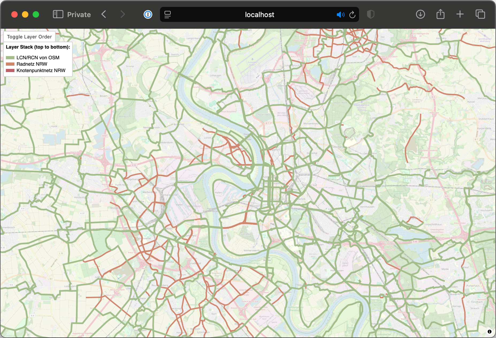

> [!CAUTION]
> This project is mostly about me trying out Claude Code and similar tools.

Compare the official NRW cycling network (Radverkehrsnetz NRW) against OpenStreetMap data. Highlights paths present in the NRW dataset but missing or incomplete in OSM.

---

## Requirements

- Docker and Docker Compose
- ~4 GB free disk space (downloads + MBTiles + PMTiles)

---

## Setup

### 1. Add local DNS entry

Add to `/etc/hosts` (Linux/macOS) or `C:\Windows\System32\drivers\etc\hosts` (Windows):

```
127.0.0.1  osm.app.internal
```

### 2. Download and process data

```bash
docker compose -f docker-compose.dataprocessing.yml run --rm dataprocessor
```

Downloads the NRW GPKG files and NRW OSM extract (~860 MB), builds vector tiles, then runs the spatial diff. Files are skipped if the server has no newer version; tiles are always regenerated from whatever data is present.

### 3. Start the application

```bash
docker compose -f docker-compose.runtime.yml up -d
```

The app is then available at **http://osm.app.internal:8080**

---

## Operations

### Check data status

```bash
docker compose -f docker-compose.dataprocessing.yml run --rm dataprocessor ./status.sh
```

Shows which files are present, when they were downloaded, and whether the upstream sources have newer versions available.

### Update data

Re-run the command from step 2. The download scripts compare the server's `Last-Modified` header against what was last downloaded and only fetch what has changed. The diff is always recomputed at the end.

To force a re-download regardless of version, delete the metadata file first:

```bash
rm data/.nrw_meta   # force re-download of NRW data
rm data/.osm_meta   # force re-download of OSM extract
```

Tiles are static PMTiles files served straight off disk, so there's no server-side cache or process to restart — nginx picks up the new files on the next request. PMTiles responses are sent with a 24h `Cache-Control` header (see `reverse-proxy.conf`), so a browser that already loaded a layer may keep serving it from its own cache for up to a day after an update.

---

## Architecture

| Component | Image | Role |
|---|---|---|
| `dataprocessor` | Ubuntu 24.04 + gdal/osmium/tippecanoe/go-pmtiles | Downloads data, converts GPKG/OSM → GeoJSON → MBTiles → PMTiles |
| `nginx` | nginx | Serves the frontend and the PMTiles files as static assets |

Tile requests (`/tiles/*.pmtiles`) are served by nginx directly from disk. MapLibre's `pmtiles` protocol handler fetches individual tiles out of each archive with HTTP range requests — there's no tile-serving process, TileJSON endpoint, or cache to manage.

### Data pipeline

**NRW official data:**
GPKG (EPSG:25832) → `ogr2ogr` (reproject to WGS84) → GeoJSON → `tippecanoe` → MBTiles → `pmtiles convert` → PMTiles

**OSM data:**
Geofabrik PBF → `osmium` (filter by tags) → PBF → `osmium export` → GeoJSON → `tippecanoe` → MBTiles → `pmtiles convert` → PMTiles

### Tile sources

Each dataset is built as `<name>.mbtiles` (tippecanoe output, kept around for inspection in tools like QGIS) and then converted to `<name>.pmtiles`, which is what the frontend actually loads.

| Name | Content |
|---|---|
| `radnetz_nw` | NRW cycling network lines |
| `knotenpunktnetz_nw` | NRW junction network lines |
| `knotenpunkte_nw` | NRW junction nodes |
| `baustellen_nw` | NRW roadworks (points) |
| `radnetz_rcn_osm` | OSM regional cycling routes |
| `r_radwege_nrw_osm` | OSM R-Radwege NRW routes |
| `knotenpunktnetz_osm` | OSM cycling junction network |
| `knotenpunkte_osm` | OSM cycling junction nodes |
| `network_diff` | Knotenpunktnetz diff — red: NRW-only gaps, blue: OSM-only segments |

### Diff

`diff.sh` runs after both download scripts. It compares `knotenpunktnetz_nw.geojson` against `knotenpunktnetz_osm.geojson` with a 25 m spatial buffer and writes `diff/network_diff.geojson` + `tiles/network_diff.mbtiles`/`.pmtiles`. `diff.py` accepts `--nrw-file`, `--osm-file`, `--out-file`, and `--buffer-m` if you want to compare other layer pairs.

---

## Frontend

Static files in `public/`. No build step — uses `@tailwindcss/browser` (bundled in `public/thirdparty/`) to process Tailwind classes at runtime. Custom styles are in `public/main.css`.

Map style is defined in `public/style.json`.

---

## Data sources and licenses

- **Radverkehrsnetz NRW**: [radverkehrsnetz.nrw.de](https://www.radverkehrsnetz.nrw.de) — [DL-DE→Zero-2.0](https://www.govdata.de/dl-de/zero-2-0)
- **OpenStreetMap**: [openstreetmap.org](https://www.openstreetmap.org) — [ODbL](https://www.openstreetmap.org/copyright)
- **Geofabrik NRW extract**: [download.geofabrik.de](https://download.geofabrik.de/europe/germany/nordrhein-westfalen.html)
